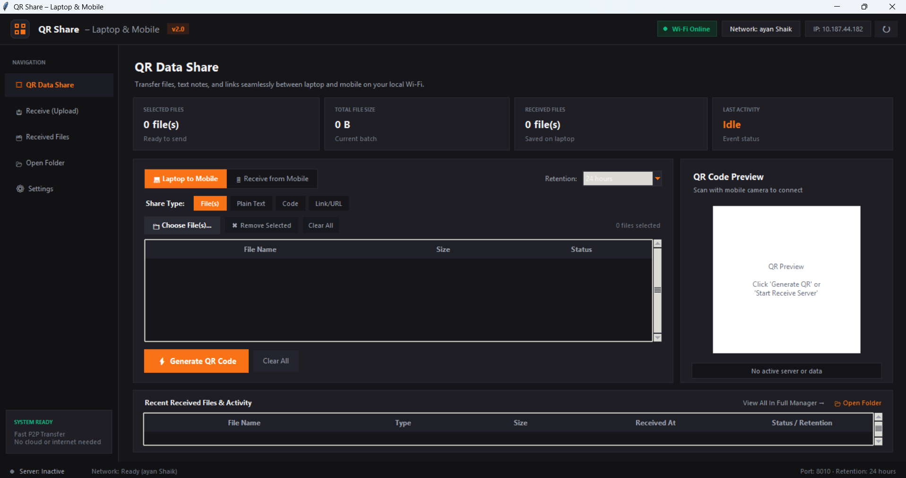

# Wireless File Share App

A Python Flask application that enables wireless file sharing between a laptop and a mobile device using QR codes and a local Wi-Fi network.

## Application Preview



## Features

- QR-code-based access from mobile devices
- Laptop-to-mobile file sharing
- Mobile-to-laptop file uploads
- Wireless transfer over a local network
- Simple web-based interface
- Python Flask backend
- QR code generation for convenient access

## Tech Stack

- **Language:** Python
- **Backend:** Flask
- **Interface:** HTML and CSS (where used by the application)
- **Feature:** QR code generation
- **Network:** Local Wi-Fi

## Project Structure

```text
wireless-file-share-app/
|-- assets/
|   `-- dashboard.png
|-- app.py
|-- server.py
|-- handler.py
|-- browser_launcher.py
|-- qr_generator.py
|-- requirements.txt
|-- utils.py
|-- .gitignore
`-- README.md
```

## Installation and Setup

### 1. Clone the repository

```bash
git clone https://github.com/Ayanshaikh-1209/wireless-file-share-app.git
cd wireless-file-share-app
```

### 2. Create a virtual environment

```powershell
python -m venv .venv
```

Activate it on Windows PowerShell:

```powershell
.\.venv\Scripts\Activate.ps1
```

### 3. Install dependencies

```powershell
python -m pip install -r requirements.txt
```

### 4. Run the application

```powershell
python app.py
```

Follow the terminal instructions to open the application.

## How to Use

1. Start the application on your laptop.
2. Connect your laptop and mobile device to the same trusted Wi-Fi network.
3. Open the mobile access link or scan the QR code provided by the application.
4. Choose the available sharing option.
5. Transfer files between your devices using the application's interface.

## Security Notes

- Use the application only on a trusted local network.
- Do not expose the development server directly to the public internet.
- Transfer only files you intend to share.
- Keep dependencies updated and validate files before opening them.

## Future Improvements

- File transfer progress indicators
- Enhanced error handling
- Additional file validation and security checks
- Further improvements to mobile responsiveness

## Author

**Ayan Shaikh**

GitHub: [Ayanshaikh-1209](https://github.com/Ayanshaikh-1209)

## License

This project is available for educational and portfolio purposes. A formal open-source license can be added if required.
